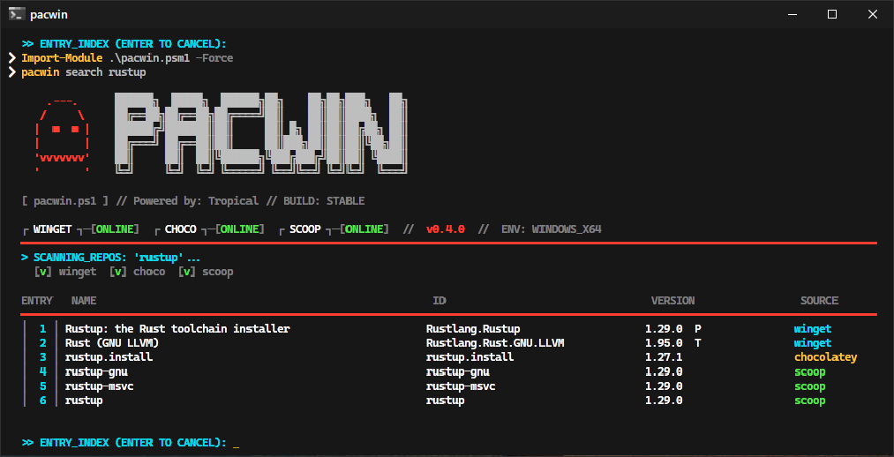
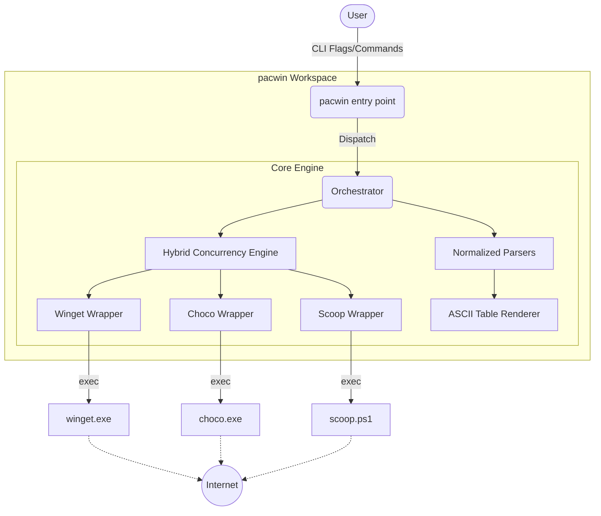
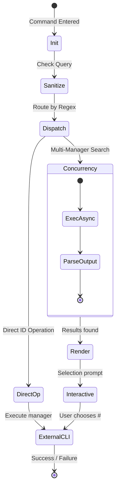

<table border="0">
  <tr>
    <td width="200" align="center" valign="top">
      
    </td>
    <td valign="top">
      <h1>pacwin</h1>
      <p><strong>Package management layer for Windows</strong><br/>
      <em>Unified, pacman-inspired interface for winget, chocolatey, and scoop.</em></p>
      <p>
        <a href="https://www.powershellgallery.com/packages/pacwin"></a>
        <a href="LICENSE"></a>
        
        
      </p>
    </td>
  </tr>
</table>

---

<p align="center">
  
</p>

---

<!--toc:start-->
- [Overview](#overview)
- [Usage](#usage)
- [Installation](#installation)
- [Features](#features)
- [Technical Architecture](#technical-architecture)
- [Core Lifecycle](#core-lifecycle)
- [Command Reference](#command-reference)
- [Roadmap](#roadmap)
- [Acknowledgments](#acknowledgments)
- [Contributing](#contributing)
- [License](#license)
<!--toc:end-->

## Overview

**pacwin** unifies **winget**, **chocolatey**, and **scoop** through a consistent syntax. It provides a CLI to interact with multiple package managers concurrently using PowerShell.

The core module, `pacwin.psm1`, manages orchestration and interpretive error handling across fragmented tools.

---

## Usage

The CLI supports standard package management operations using either descriptive flags or shorthand.

<p align="center">
  
</p>

```powershell
pacwin -Ss vim        # Search all managers
pacwin -S neovim      # Install package
pacwin -Syu           # Update all packages
```

**Key Capabilities:**
* **Consistent Syntax:** Maps Linux-style commands to Windows package managers.
* **Concurrency:** Uses PowerShell Runspaces for asynchronous searches and operations.
* **Error Interpretation:** Decodes Windows exit codes in real-time.
* **Filtering:** Supports specific manager selection via the `-Manager` flag.

---

## Installation

### PowerShell Gallery

```powershell
Install-Module -Name pacwin -Scope CurrentUser
```

### Scripted Installation

```powershell
curl -sSL https://raw.githubusercontent.com/julesklord/pacwin/main/get-pacwin.ps1 | powershell -Command -
```

### From Source

```powershell
git clone https://github.com/julesklord/pacwin.git
cd pacwin
.\install.ps1
```

---

## Features (v0.4.2)

*   **Multi-Manager Search**: Scans Winget, Chocolatey, and Scoop concurrently.
*   **sfsu Integration**: Uses `sfsu` for Scoop operations when available.
*   **Robust Parsers**: Processes tabular output independent of system locale.
*   **Interactive Selection**: Provides numbered prompts for package selection.
*   **Security**: Validates input and paths to prevent shell injection.
*   **Compatibility**: Supports Windows PowerShell 5.1 and PowerShell 7+.
*   **Diagnostics**: Verifies manager status and PATH configuration.

---

## Technical Architecture

pacwin standardizes input and normalizes output from external package managers.



### Core Components

- **`pacwin.psm1`**: Main script module for dispatch logic and search engine management.
- **`_pw_search_all`**: Concurrency core using RunspacePool.
- **`_pw_parse_*`**: Format-specific parsers for each package manager.

---

## Core Lifecycle



### Engineering Decisions

- **Portability:** Single-file distribution without external dependencies.
- **Efficiency:** Thread-based concurrency within the existing process.
- **Data Model:** Emits standard `PSCustomObject` instances for pipeline integration.

---

## Command Reference

View the **[Wiki](docs/wiki/index.md)** for details.  

*   **[Installation Guide](docs/wiki/Installation.md)**
*   **[CLI Command Reference](docs/wiki/Command_Reference.md)**
*   **[Technical Architecture](docs/wiki/architecture.md)**

| Command | Alias | Description |
| :--- | :--- | :--- |
| `pacwin search` | `-Ss` | Search across managers. |
| `pacwin install` | `-S` | Install a package. |
| `pacwin update` | `-Syu` | Update installed packages. |
| `pacwin list` | `-Q` | View installed packages. |
| `pacwin doctor` | `check` | Verify system health. |

---

## Roadmap

| Version | Status | Milestone |
| --- | --- | --- |
| **v0.1.0** | ✅ | First hybrid search engine. |
| **v0.2.0** | ✅ | Export/Import and Tab Completion. |
| **v0.3.0** | ✅ | Major performance refactor & test coverage. |
| **v0.4.0** | ✅ | Brand redesign (Pitahaya style) & ASCII banner. |
| **v0.4.1** | ✅ | sfsu support, locale-independence, and PowerShell 5.1/Pester 3 compatibility. |
| **v0.4.2** | ✅ | Streamlined flat parsers with clean early-return checks. |
| **v0.6.0** | ✅ | Command Pattern architecture, precompiled regex parsers, and full integration test suite. |
---

## Acknowledgments

- **Arch Linux Pacman**: Inspiring the command syntax.
- **Scoop**: Providing Windows package management capabilities.

## Contributing

Submit pull requests for changes. Open an RFC issue first for major updates. See `CONTRIBUTING.md`.

## License

MIT License.
