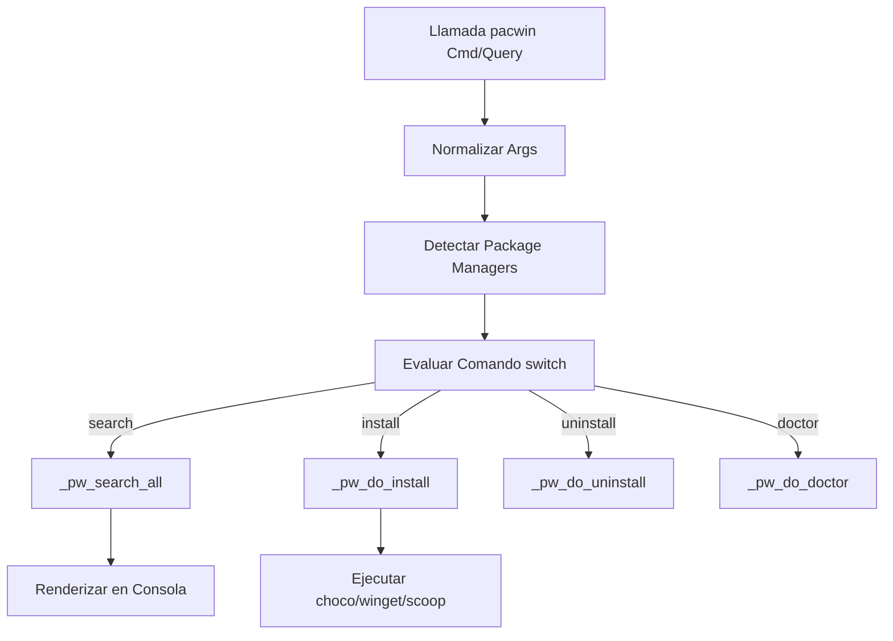

# Arquitectura de Comandos — pacwin

Este documento detalla el diseño de comandos del módulo **pacwin**, explicando la transición entre el flujo monolítico actual y el patrón Command planificado para la Fase 3.

---

## 1. Mapeo de Comandos Actuales

El punto de entrada principal es la función `pacwin`. Acepta un parámetro `-Command` que es normalizado y despachado internamente.

### Mapeo de Atajos y Alias

| Comando Corto | Comando Completo | Flujo Interno / Función Destino |
|:--------------|:-----------------|:--------------------------------|
| `-Ss`         | `search`         | `_pw_search_all`                |
| `-S`          | `install`        | `_pw_do_install`                |
| `-R`          | `uninstall`      | `_pw_do_uninstall`              |
| `-Syu`        | `update`         | `_pw_do_update_all` (sin query) |
| `-Syu <pkg>`  | `update <pkg>`   | `_pw_do_update_single`          |
| `-Qu`         | `outdated`       | `_pw_do_outdated`               |
| `-Q`          | `list`           | `_pw_do_list`                   |

---

## 2. Flujo de Ejecución (Monolítico)

Actualmente, el despacho se realiza en la función principal `pacwin` mediante una estructura condicional `switch -Regex ($Command)` que gestiona los siguientes pasos secuenciales:



---

## 3. Arquitectura Objetivo: Patrón Command (Fase 3)

Para mejorar la testabilidad y reducir la complejidad ciclomática de `pacwin.psm1`, los comandos se refactorizarán en archivos individuales dentro del directorio `internal/commands/`.

### Estructura de Clases / Comandos Propuesta

Cada comando implementará una firma de bloque de script o clase conceptual que acepte un contexto común:

```powershell
$CommandMap = @{
    'search'  = { param($Context) _pw_cmd_search @Context }
    'install' = { param($Context) _pw_cmd_install @Context }
    'update'  = { param($Context) _pw_cmd_update @Context }
    # ...
}
```

El `$Context` contendrá:
- `Query`: Parámetro opcional de búsqueda o destino.
- `Managers`: Lista filtrada de managers de paquetes activos.
- `Limit` / `Timeout`: Parámetros de configuración del flujo.
- `Interactive`: Interruptor para desactivar prompts visuales.
